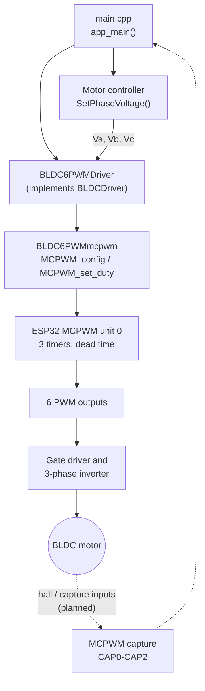
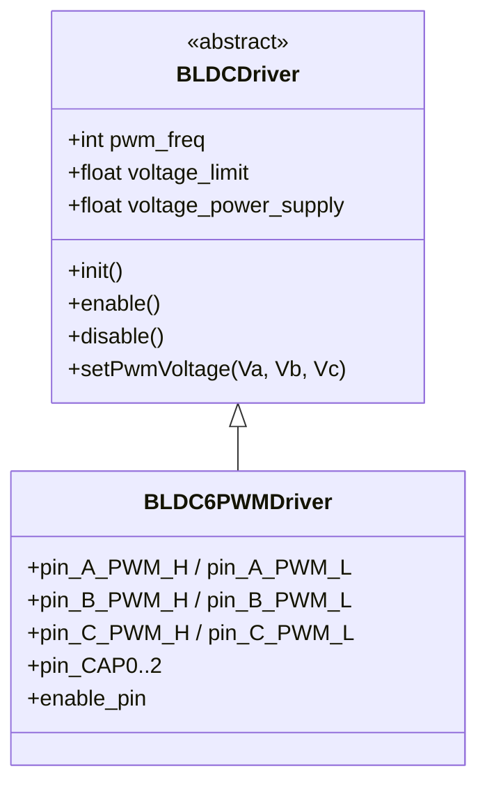
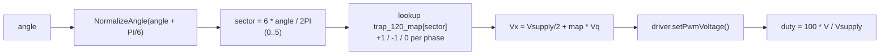

# ESC-S25

Firmware for a 3-phase brushless DC (BLDC) electronic speed controller (ESC), built for the ESP32 with ESP-IDF and the MCPWM peripheral. It drives a 6-PWM half-bridge gate driver with complementary outputs and hardware dead time.

Developed by the Electrium Mobility ESC team (Spring 2025).

> **Status:** feature complete. Trapezoidal 120, sinusoidal and space-vector modulation, open-loop and hall-based closed-loop speed control, throttle input and a PID are implemented. The firmware has not been compiled or run on hardware yet, so expect to tune the gains and check hall wiring on the bench.

## Features

- Three modulation schemes, switched with the global `modulation`: `Trapezoid_120`, `Sinusoidal`, `Space_Vector` (min/max injection, about 15% more usable voltage than plain sine).
- Open-loop speed control (`VelocityOpenLoop`) that integrates the angle from real elapsed time.
- Closed-loop speed control: hall sensors give position and speed, a PID sets the q-axis voltage.
- Potentiometer throttle on an ADC1 pin with filtering, deadband, start/stop hysteresis and an acceleration limit.
- Protection: phase voltage clamped to what the supply and modulation can deliver, gate driver enable pin, shutdown on invalid hall code or throttle release.

Control mode and tuning constants (pole pairs, speed limit, voltages, PID gains) are in [`main/inc/main.h`](ESC-S25/main/inc/main.h). Set `CONTROL_MODE` to `CONTROL_OPEN_LOOP` or `CONTROL_CLOSED_LOOP`.

## Architecture



### Class structure



### Commutation (120° trapezoidal)



A hand-drawn flowchart is also in [`Motor FlowChart.drawio`](Motor%20FlowChart.drawio) and [`ESC-S25/Untitled Diagram.drawio`](ESC-S25/Untitled%20Diagram.drawio).

## Repository layout

```
ESC-S25/
├── CMakeLists.txt            ESP-IDF project file
├── sdkconfig                 Target config (ESP32)
├── diagram.json, wokwi.toml  Wokwi simulation setup
├── scrap.cpp                 Scratch notes, not part of the build
└── main/
    ├── CMakeLists.txt
    ├── inc/                  Headers (main.h, PWM/, motor/, motor/drivers/, misc/)
    └── src/
        ├── main.cpp                         Entry point and control task
        ├── control/PID.cpp                  PID with anti-windup and ramp
        ├── sensors/HallSensor.cpp           Hall position and speed
        ├── input/SpeedInput.cpp             Throttle ADC input
        ├── PWM/BLDC6PWMmcpwm.cpp            MCPWM pin, timer and duty setup
        └── motor/
            ├── BLDC6PWMmotor_controller.cpp Modulation (trapezoidal 120)
            └── drivers/BLDC6PWMDriver.cpp   6-PWM driver
```

## Pin map

| Signal | GPIO | Signal | GPIO |
| ------ | ---- | ------ | ---- |
| Phase A high / low | 18 / 19 | Capture 0 | 26 |
| Phase B high / low | 21 / 22 | Capture 1 | 27 |
| Phase C high / low | 23 / 25 | Capture 2 | 32 |
| Gate driver enable | 4 | Throttle (ADC1) | 34 |

The capture pins double as the three hall sensor inputs. If the motor runs backwards in closed loop, swap two hall wires or set `hall.reversed`.

Pins are defined in [`main/inc/main.h`](ESC-S25/main/inc/main.h).

## Build and flash

Requires [ESP-IDF](https://docs.espressif.com/projects/esp-idf/en/v5.4.1/esp32/get-started/index.html) v5.4.x.

```sh
cd ESC-S25
idf.py set-target esp32
idf.py build
idf.py -p <PORT> flash monitor
```

The MCPWM code uses the legacy `driver/mcpwm.h` API, which is deprecated in ESP-IDF 5.x but still supported. Do not mix it with the newer `mcpwm_prelude.h` API in the same firmware.

## Safety

This drives power electronics. Test with a current-limited bench supply and no propeller or load attached first. Verify dead time on a scope before connecting a motor. There is no current or temperature sensing, so rely on the bench supply's current limit.
